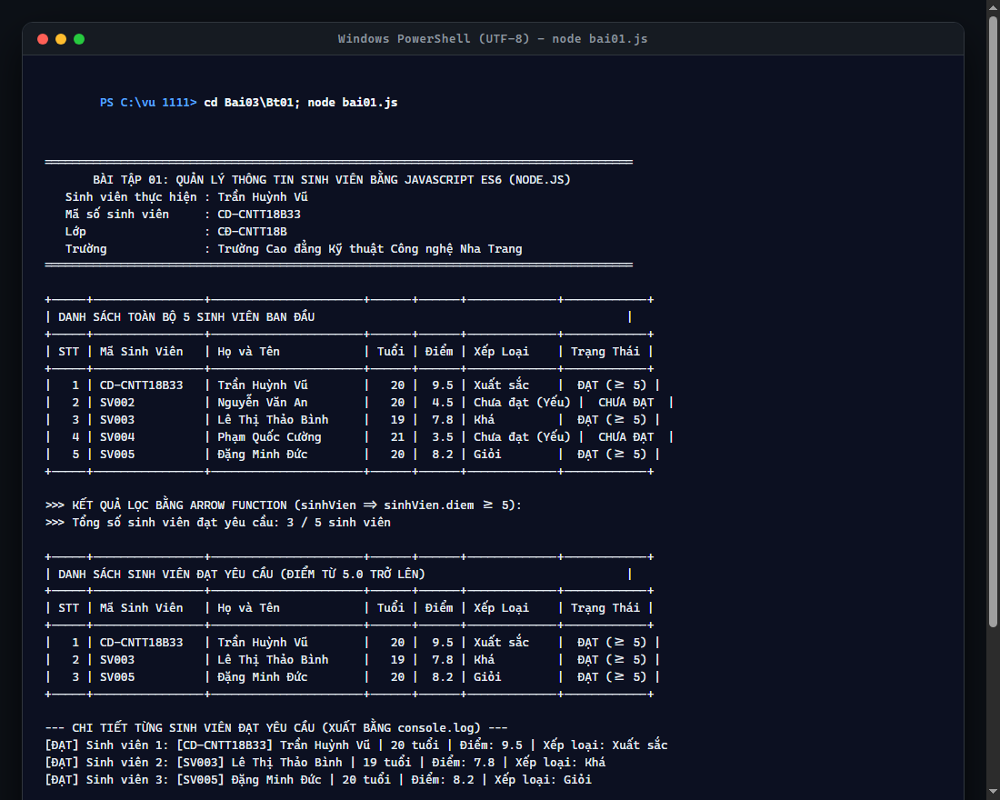

# BÀI TẬP 01: QUẢN LÝ THÔNG TIN SINH VIÊN BẰNG JAVASCRIPT ES6

## 📌 THÔNG TIN SINH VIÊN THỰC HIỆN
* **Họ và tên:** **Trần Huỳnh Vũ**
* **Mã sinh viên (MSSV):** **CD-CNTT18B33**
* **Lớp:** **CĐ-CNTT18B**
* **Khoa:** Khoa Công nghệ Thông tin
* **Trường:** Trường Cao đẳng Kỹ thuật Công nghệ Nha Trang
* **Repository GitHub:** [https://github.com/vuu111/Node-JS](https://github.com/vuu111/Node-JS)

---

## 🎯 YÊU CẦU BÀI THỰC HÀNH
Tạo tập tin `bai01.js` thực hiện:
1. Khai báo danh sách 5 sinh viên, mỗi sinh viên gồm `mã`, `họ tên`, `tuổi` và `điểm`.
2. Sử dụng `class`, `constructor` để biểu diễn sinh viên.
3. Sử dụng hàm mũi tên (arrow function) để lọc sinh viên có điểm từ 5 trở lên (`diem >= 5`).
4. Hiển thị danh sách sinh viên đạt yêu cầu bằng `console.log()`.
5. Chạy: `node bai01.js`
6. Kết quả: Terminal hiển thị đúng danh sách sinh viên đạt yêu cầu.

---

## 💻 CÁC LỆNH THỰC HIỆN TRÊN MÁY TÍNH

> **Lưu ý chống lỗi font Tiếng Việt trên Windows PowerShell:**  
> Mặc định Windows PowerShell sử dụng bảng mã `437`. Để hiển thị tiếng Việt có dấu chuẩn đẹp 100%, hãy bật bảng mã UTF-8 bằng lệnh `chcp 65001` trước khi chạy `node bai01.js`, hoặc nhấp đúp file `run.bat` có sẵn trong thư mục.

```powershell
# 1. Di chuyển vào thư mục bài tập Bt01
cd "C:\vu 1111\Bai03\Bt01"

# 2. Bật bảng mã UTF-8 tiếng Việt cho Terminal
chcp 65001

# 3. Chạy chương trình
node bai01.js
```
*(Hoặc chỉ cần gõ: `.\run.bat`)*

---

## 📷 HÌNH ẢNH CHẠY CÁC BƯỚC VÀ KẾT QUẢ THỰC TẾ

### Bước 1: Thực thi chương trình `node bai01.js` trên PowerShell UTF-8
Chương trình xuất bảng ASCII 5 sinh viên ban đầu, phân loại học lực, lọc danh sách điểm từ 5.0 trở lên bằng hàm mũi tên arrow function và tổng hợp thống kê:



---

## 📊 KẾT QUẢ XUẤT RA TERMINAL

```text
=====================================================================================
       BÀI TẬP 01: QUẢN LÝ THÔNG TIN SINH VIÊN BẰNG JAVASCRIPT ES6 (NODE.JS)         
   Sinh viên thực hiện : Trần Huỳnh Vũ                                               
   Mã số sinh viên     : CD-CNTT18B33                                                
   Lớp                 : CĐ-CNTT18B                                                  
   Trường              : Trường Cao đẳng Kỹ thuật Công nghệ Nha Trang                
=====================================================================================

+-----+----------------+----------------------+------+------+-------------+------------+
| DANH SÁCH TOÀN BỘ 5 SINH VIÊN BAN ĐẦU                                             |
+-----+----------------+----------------------+------+------+-------------+------------+
| STT | Mã Sinh Viên   | Họ và Tên            | Tuổi | Điểm | Xếp Loại    | Trạng Thái |
+-----+----------------+----------------------+------+------+-------------+------------+
|   1 | CD-CNTT18B33   | Trần Huỳnh Vũ        |   20 |  9.5 | Xuất sắc    |  ĐẠT (>= 5) |
|   2 | SV002          | Nguyễn Văn An        |   20 |  4.5 | Chưa đạt (Yếu) |  CHƯA ĐẠT  |
|   3 | SV003          | Lê Thị Thảo Bình     |   19 |  7.8 | Khá         |  ĐẠT (>= 5) |
|   4 | SV004          | Phạm Quốc Cường      |   21 |  3.5 | Chưa đạt (Yếu) |  CHƯA ĐẠT  |
|   5 | SV005          | Đặng Minh Đức        |   20 |  8.2 | Giỏi        |  ĐẠT (>= 5) |
+-----+----------------+----------------------+------+------+-------------+------------+

>>> KẾT QUẢ LỌC BẰNG ARROW FUNCTION (sinhVien => sinhVien.diem >= 5):
>>> Tổng số sinh viên đạt yêu cầu: 3 / 5 sinh viên

+-----+----------------+----------------------+------+------+-------------+------------+
| DANH SÁCH SINH VIÊN ĐẠT YÊU CẦU (ĐIỂM TỪ 5.0 TRỞ LÊN)                             |
+-----+----------------+----------------------+------+------+-------------+------------+
| STT | Mã Sinh Viên   | Họ và Tên            | Tuổi | Điểm | Xếp Loại    | Trạng Thái |
+-----+----------------+----------------------+------+------+-------------+------------+
|   1 | CD-CNTT18B33   | Trần Huỳnh Vũ        |   20 |  9.5 | Xuất sắc    |  ĐẠT (>= 5) |
|   2 | SV003          | Lê Thị Thảo Bình     |   19 |  7.8 | Khá         |  ĐẠT (>= 5) |
|   3 | SV005          | Đặng Minh Đức        |   20 |  8.2 | Giỏi        |  ĐẠT (>= 5) |
+-----+----------------+----------------------+------+------+-------------+------------+

--- CHI TIẾT TỪNG SINH VIÊN ĐẠT YÊU CẦU (XUẤT BẰNG console.log) ---
[ĐẠT] Sinh viên 1: [CD-CNTT18B33] Trần Huỳnh Vũ | 20 tuổi | Điểm: 9.5 | Xếp loại: Xuất sắc
[ĐẠT] Sinh viên 2: [SV003] Lê Thị Thảo Bình | 19 tuổi | Điểm: 7.8 | Xếp loại: Khá
[ĐẠT] Sinh viên 3: [SV005] Đặng Minh Đức | 20 tuổi | Điểm: 8.2 | Xếp loại: Giỏi

======================== THỐNG KÊ KẾT QUẢ ĐÁNH GIÁ ========================
* Tổng số sinh viên quản lý   : 5 sinh viên
* Số lượng sinh viên ĐẠT      : 3 sinh viên (60%)
* Số lượng sinh viên CHƯA ĐẠT : 2 sinh viên
* Điểm trung bình cả lớp      : 6.70 điểm
* Điểm số cao nhất            : 9.5 điểm (Trần Huỳnh Vũ)
===========================================================================
```

---

## 🔍 GIẢI THÍCH MÃ NGUỒN KỸ THUẬT ES6
* **Cú pháp Class & Constructor (ES6):**
  Lớp `SinhVien` biểu diễn đối tượng sinh viên với 4 thuộc tính: `ma`, `hoTen`, `tuoi`, `diem` cùng các phương thức `xepLoai()`, `kiemTraDat()`, `thongTin()`.
* **Hàm mũi tên (Arrow Function `=>`):**
  Lọc sinh viên có điểm từ 5 trở lên:
  ```javascript
  const sinhVienDat = danhSachSinhVien.filter(sinhVien => sinhVien.diem >= 5);
  ```
* **Giao diện bảng ASCII chuẩn:** Sử dụng các ký tự chuẩn ANSI `+`, `-`, `|` giúp giao diện Terminal hiển thị thẳng hàng, chống triệt để tình trạng vỡ khung `ΓöÉΓöÇ` trên các môi trường Command Line khác nhau.