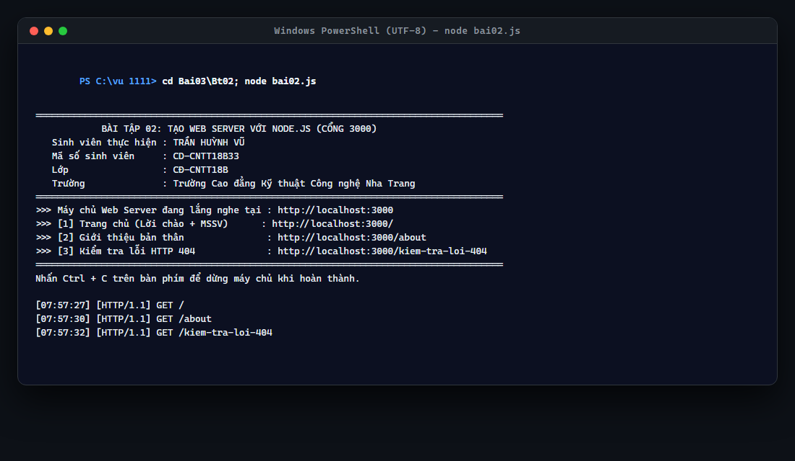
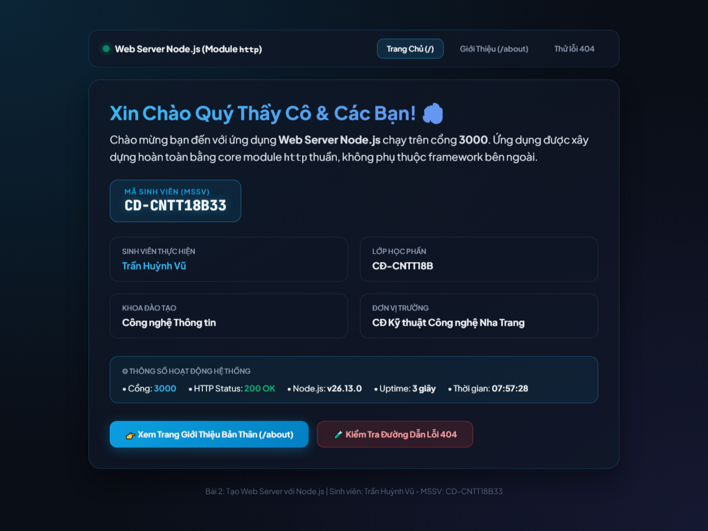
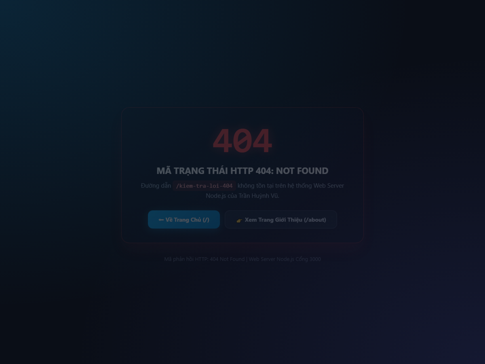

# BÀI TẬP 02: TẠO WEB SERVER VỚI NODE.JS (NÂNG CẤP GIAO DIỆN BENTO TECH)

## 📌 THÔNG TIN SINH VIÊN THỰC HIỆN
* **Họ và tên:** **Trần Huỳnh Vũ**
* **Mã sinh viên (MSSV):** **CD-CNTT18B33**
* **Lớp:** **CĐ-CNTT18B**
* **Khoa:** Khoa Công nghệ Thông tin
* **Trường:** Trường Cao đẳng Kỹ thuật Công nghệ Nha Trang
* **Repository GitHub:** [https://github.com/vuu111/Node-JS](https://github.com/vuu111/Node-JS)

---

## 🎯 YÊU CẦU BÀI THỰC HÀNH
Tạo tập tin `bai02.js` thực hiện:
1. Sử dụng module `http` tạo Web Server tại cổng 3000 (`PORT = 3000`).
2. Khi truy cập `/`, hiển thị **lời chào** và **mã sinh viên**.
3. Khi truy cập `/about`, hiển thị **thông tin giới thiệu bản thân**.
4. Khi truy cập đường dẫn không tồn tại, trả về **mã trạng thái HTTP 404**.
5. Chạy: `node bai02.js`
6. Kết quả: Trình duyệt hiển thị đúng nội dung tại `http://localhost:3000` và `http://localhost:3000/about`.

---

## 💻 CÁC LỆNH THỰC HIỆN TRÊN MÁY TÍNH
Mở terminal tại thư mục bài tập và thực thi:

```powershell
# 1. Di chuyển vào thư mục bài tập Bt02
cd "C:\vu 1111\Bai03\Bt02"

# 2. Khởi động Web Server (cổng 3000)
node bai02.js
```
*(Hoặc nhấp đúp chạy file `run.bat` có sẵn trong thư mục).*

Sau khi máy chủ khởi động, mở trình duyệt Web (Google Chrome / Edge) và truy cập:
* Trang chủ: [http://localhost:3000/](http://localhost:3000/)
* Giới thiệu bản thân: [http://localhost:3000/about](http://localhost:3000/about)
* Kiểm tra lỗi 404: [http://localhost:3000/kiem-tra-loi-404](http://localhost:3000/kiem-tra-loi-404)

---

## 📷 HÌNH ẢNH CHẠY CÁC BƯỚC VÀ GIAO DIỆN NÂNG CẤP THỰC TẾ

### Bước 1: Khởi động Web Server trên PowerShell
Máy chủ Node.js hiển thị thông tin sinh viên Trần Huỳnh Vũ, cổng 3000 và ghi log chi tiết mọi lượt request:



---

### Bước 2: Trang chủ `http://localhost:3000/` (Giao diện Bento Tech UI)
Trang chủ hiển thị lời chào trân trọng, nổi bật khung Mã sinh viên: **CD-CNTT18B33**, thông tin lớp, trường, thông số hoạt động của server và đồng hồ thời gian thực:



---

### Bước 3: Trang giới thiệu bản thân `http://localhost:3000/about`
Trình duyệt hiển thị hồ sơ cá nhân đầy đủ: Họ tên, MSSV, Lớp, Khoa, Trường, khối kỹ năng môn học Node.js và định hướng phát triển trở thành Fullstack Web Developer:


---

### Bước 4: Trang báo lỗi 404 `http://localhost:3000/kiem-tra-loi-404`
Khi truy cập URL không tồn tại, máy chủ trả về mã trạng thái **HTTP 404 Not Found** với giao diện cảnh báo phong cách Cyberpunk và nút điều hướng về trang chủ an toàn:



---

## 🔍 TÍNH NĂNG NÂNG CẤP NỔI BẬT CỦA GIAO DIỆN
1. **Phong cách Glassmorphism & Bento Tech UI:** Sử dụng lớp nền bán trong suốt `backdrop-filter: blur(16px)` cùng dải màu Gradient Cyan/Emerald hiện đại.
2. **Thanh điều hướng Navigation Bar:** Giúp chuyển đổi mượt mà giữa các trang (`/`, `/about`, `/kiem-tra-loi-404`).
3. **Đồng hồ thời gian thực:** Đồng hồ góc phải hiển thị giờ địa phương chuẩn xác theo thời gian thực tế.
4. **Chuẩn hóa UTF-8:** Header `Content-Type: text/html; charset=utf-8` hiển thị tiếng Việt hoàn hảo trên mọi thiết bị.