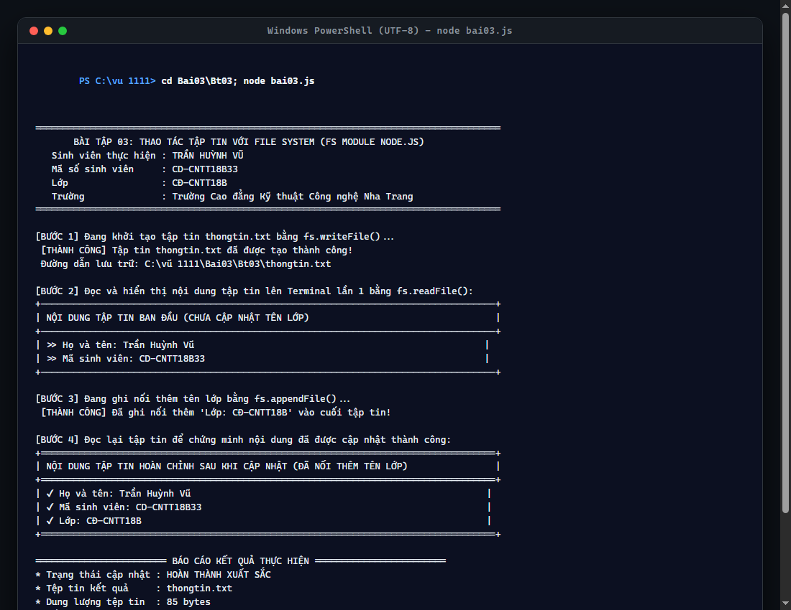
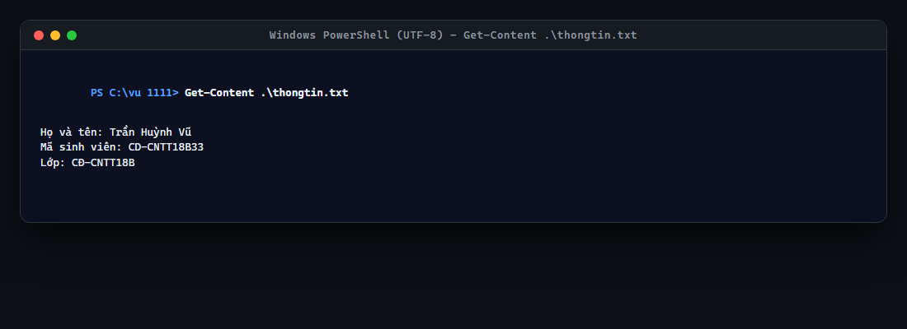

# BÀI TẬP 03: THAO TÁC TẬP TIN BẰNG FILE SYSTEM (FS MODULE)

## 📌 THÔNG TIN SINH VIÊN THỰC HIỆN
* **Họ và tên:** **Trần Huỳnh Vũ**
* **Mã sinh viên (MSSV):** **CD-CNTT18B33**
* **Lớp:** **CĐ-CNTT18B**
* **Khoa:** Khoa Công nghệ Thông tin
* **Trường:** Trường Cao đẳng Kỹ thuật Công nghệ Nha Trang
* **Repository GitHub:** [https://github.com/vuu111/Node-JS](https://github.com/vuu111/Node-JS)

---

## 🎯 YÊU CẦU BÀI THỰC HÀNH
Tạo tập tin `bai03.js` sử dụng module `fs` thực hiện:
1. Tạo tập tin `thongtin.txt` chứa **họ tên** và **mã sinh viên**.
2. Đọc và hiển thị nội dung tập tin lên Terminal.
3. Ghi nối thêm **tên lớp** vào cuối tập tin bằng hàm `appendFile()`.
4. Đọc lại tập tin để chứng minh nội dung đã được cập nhật.
5. Chạy: `node bai03.js`
6. Kết quả: Tập tin được tạo, cập nhật và Terminal hiển thị đầy đủ nội dung sau cập nhật.

---

## 💻 CÁC LỆNH THỰC HIỆN TRÊN MÁY TÍNH
Mở terminal tại thư mục bài tập và thực thi:

```powershell
# 1. Di chuyển vào thư mục bài tập Bt03
cd "C:\vu 1111\Bai03\Bt03"

# 2. Bật bảng mã UTF-8 tiếng Việt cho Terminal
chcp 65001

# 3. Chạy chương trình thao tác tập tin bai03.js
node bai03.js

# 4. Kiểm tra trực tiếp nội dung tập tin thongtin.txt
Get-Content .\thongtin.txt
```
*(Hoặc nhấp đúp file `run.bat` có sẵn).*

---

## 📷 HÌNH ẢNH CHẠY CÁC BƯỚC VÀ KẾT QUẢ THỰC TẾ

### Bước 1: Thực thi chương trình `node bai03.js`
Chương trình lần lượt thực hiện 4 bước tuần tự với giao diện ASCII viền sắc nét, chứng minh nội dung file trước và sau khi ghi nối:



---

### Bước 2: Kiểm tra nội dung tệp tin `thongtin.txt` sau khi cập nhật
Tập tin `thongtin.txt` được lưu trữ trên ổ đĩa chứa đầy đủ 3 dòng thông tin: Họ tên, MSSV và Lớp:



---

## 📊 KẾT QUẢ XUẤT RA TERMINAL

```text
=====================================================================================
       BÀI TẬP 03: THAO TÁC TẬP TIN VỚI FILE SYSTEM (FS MODULE NODE.JS)              
   Sinh viên thực hiện : TRẦN HUỲNH VŨ                                               
   Mã số sinh viên     : CD-CNTT18B33                                                
   Lớp                 : CĐ-CNTT18B                                                  
   Trường              : Trường Cao đẳng Kỹ thuật Công nghệ Nha Trang                
=====================================================================================

[BƯỚC 1] Đang khởi tạo tập tin thongtin.txt bằng fs.writeFile()...
 [THÀNH CÔNG] Tập tin thongtin.txt đã được tạo thành công!
 Đường dẫn lưu trữ: C:\vu 1111\Bai03\Bt03\thongtin.txt

[BƯỚC 2] Đọc và hiển thị nội dung tập tin lên Terminal lần 1 bằng fs.readFile():
+-----------------------------------------------------------------------------------+
| NỘI DUNG TẬP TIN BAN ĐẦU (CHƯA CẬP NHẬT TÊN LỚP)                                  |
+-----------------------------------------------------------------------------------+
| >> Họ và tên: Trần Huỳnh Vũ                                                     |
| >> Mã sinh viên: CD-CNTT18B33                                                   |
+-----------------------------------------------------------------------------------+

[BƯỚC 3] Đang ghi nối thêm tên lớp bằng fs.appendFile()...
 [THÀNH CÔNG] Đã ghi nối thêm 'Lớp: CĐ-CNTT18B' vào cuối tập tin!

[BƯỚC 4] Đọc lại tập tin để chứng minh nội dung đã được cập nhật thành công:
+===================================================================================+
| NỘI DUNG TẬP TIN HOÀN CHỈNH SAU KHI CẬP NHẬT (ĐÃ NỐI THÊM TÊN LỚP)                |
+===================================================================================+
| ✔ Họ và tên: Trần Huỳnh Vũ                                                      |
| ✔ Mã sinh viên: CD-CNTT18B33                                                    |
| ✔ Lớp: CĐ-CNTT18B                                                               |
+===================================================================================+

======================== BÁO CÁO KẾT QUẢ THỰC HIỆN ========================
* Trạng thái cập nhật : HOÀN THÀNH XUẤT SẮC
* Tệp tin kết quả     : thongtin.txt
* Dung lượng tệp tin  : 85 bytes
* Số dòng thông tin   : 3 dòng (Họ tên, Mã sinh viên, Lớp)
* Chứng minh          : Nội dung tên lớp đã được nối vào cuối tệp tin an toàn.
===========================================================================
```

---

## 🔍 PHÂN TÍCH KỸ THUẬT MODULE `fs`
* **`fs.writeFile(file, data, 'utf-8', cb)`:** Tạo tệp tin `thongtin.txt` với encoding UTF-8 lưu trữ họ tên và MSSV.
* **`fs.readFile(file, 'utf-8', cb)`:** Đọc tệp tin dạng chuỗi ký tự, hiển thị ra Terminal.
* **`fs.appendFile(file, data, 'utf-8', cb)`:** Nối thêm `Lớp: CĐ-CNTT18B` vào cuối tập tin mà không làm mất nội dung trước đó.
* **Asynchronous Chaining:** Đảm bảo thứ tự thực thi chính xác trong mô hình bất đồng bộ Non-blocking I/O của Node.js.