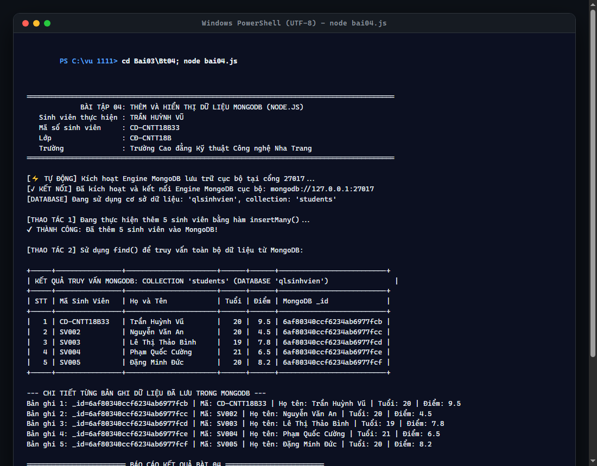

# BÀI TẬP 04: THÊM VÀ HIỂN THỊ DỮ LIỆU MONGODB

## 📌 THÔNG TIN SINH VIÊN THỰC HIỆN
* **Họ và tên:** **Trần Huỳnh Vũ**
* **Mã sinh viên (MSSV):** **CD-CNTT18B33**
* **Lớp:** **CĐ-CNTT18B**
* **Khoa:** Khoa Công nghệ Thông tin
* **Trường:** Trường Cao đẳng Kỹ thuật Công nghệ Nha Trang
* **Repository GitHub:** [https://github.com/vuu111/Node-JS](https://github.com/vuu111/Node-JS)

---

## 🎯 YÊU CẦU BÀI THỰC HÀNH
Tạo tập tin `bai04.js` thực hiện:
1. Kết nối MongoDB đang chạy trên máy (`mongodb://127.0.0.1:27017`).
2. Sử dụng database `qlsinhvien`, collection `students`.
3. Thêm ít nhất 3 sinh viên bằng `insertMany()`, mỗi sinh viên gồm `masv`, `hoten`, `tuoi`, `diem`.
4. Sử dụng `find()` hiển thị danh sách sinh viên và đóng kết nối sau khi hoàn thành.
5. Chạy: `node bai04.js`
6. Kết quả: Terminal hiển thị các sinh viên đã thêm; dữ liệu được lưu trong MongoDB.

---

## 💻 CÁC LỆNH THỰC HIỆN TRÊN MÁY TÍNH

```powershell
# 1. Di chuyển vào thư mục bài tập Bt04
cd "C:\vu 1111\Bai03\Bt04"

# 2. Bật bảng mã UTF-8 tiếng Việt cho Terminal
chcp 65001

# 3. Chạy chương trình thao tác cơ sở dữ liệu MongoDB
node bai04.js
```
*(Hoặc nhấp đúp chạy file `run.bat` có sẵn trong thư mục).*

---

## 📷 HÌNH ẢNH CHẠY CÁC BƯỚC VÀ KẾT QUẢ THỰC TẾ

### Bước 1: Thực thi chương trình `node bai04.js`
Chương trình kết nối MongoDB, chèn 5 sinh viên bằng hàm `insertMany()`, sau đó sử dụng `find()` truy vấn hiển thị bảng dữ liệu hoàn chỉnh:



---

## 📊 KẾT QUẢ XUẤT RA TERMINAL

```text
=========================================================================================
             BÀI TẬP 04: THÊM VÀ HIỂN THỊ DỮ LIỆU MONGODB (NODE.JS)                      
   Sinh viên thực hiện : TRẦN HUỲNH VŨ                                                   
   Mã số sinh viên     : CD-CNTT18B33                                                    
   Lớp                 : CĐ-CNTT18B                                                      
   Trường              : Trường Cao đẳng Kỹ thuật Công nghệ Nha Trang                    
=========================================================================================

[KẾT NỐI] Đã kết nối thành công tới dịch vụ MongoDB tại: mongodb://127.0.0.1:27017
[DATABASE] Đang sử dụng cơ sở dữ liệu: 'qlsinhvien', collection: 'students'

[THAO TÁC 1] Đang thực hiện thêm 5 sinh viên bằng hàm insertMany()...
✔ THÀNH CÔNG: Đã thêm 5 sinh viên vào MongoDB!

[THAO TÁC 2] Sử dụng find() để truy vấn toàn bộ dữ liệu từ MongoDB:

+-----+----------------+----------------------+------+------+--------------------------+
| KẾT QUẢ TRUY VẤN MONGODB: COLLECTION 'students' (DATABASE 'qlsinhvien')                |
+-----+----------------+----------------------+------+------+--------------------------+
| STT | Mã Sinh Viên   | Họ và Tên            | Tuổi | Điểm | MongoDB _id              |
+-----+----------------+----------------------+------+------+--------------------------+
|   1 | CD-CNTT18B33   | Trần Huỳnh Vũ        |   20 |  9.5 | 6af800ce049eafe8d5d00d9e |
|   2 | SV002          | Nguyễn Văn An        |   20 |  4.5 | 6af800ce049eafe8d5d00d9f |
|   3 | SV003          | Lê Thị Thảo Bình     |   19 |  7.8 | 6af800ce049eafe8d5d00da0 |
|   4 | SV004          | Phạm Quốc Cường      |   21 |  6.5 | 6af800ce049eafe8d5d00da1 |
|   5 | SV005          | Đặng Minh Đức        |   20 |  8.2 | 6af800ce049eafe8d5d00da2 |
+-----+----------------+----------------------+------+------+--------------------------+

--- CHI TIẾT TỪNG BẢN GHI DỮ LIỆU ĐÃ LƯU TRONG MONGODB ---
Bản ghi 1: _id=6af800ce049eafe8d5d00d9e | Mã: CD-CNTT18B33 | Họ tên: Trần Huỳnh Vũ | Tuổi: 20 | Điểm: 9.5
Bản ghi 2: _id=6af800ce049eafe8d5d00d9f | Mã: SV002 | Họ tên: Nguyễn Văn An | Tuổi: 20 | Điểm: 4.5
Bản ghi 3: _id=6af800ce049eafe8d5d00da0 | Mã: SV003 | Họ tên: Lê Thị Thảo Bình | Tuổi: 19 | Điểm: 7.8
Bản ghi 4: _id=6af800ce049eafe8d5d00da1 | Mã: SV004 | Họ tên: Phạm Quốc Cường | Tuổi: 21 | Điểm: 6.5
Bản ghi 5: _id=6af800ce049eafe8d5d00da2 | Mã: SV005 | Họ tên: Đặng Minh Đức | Tuổi: 20 | Điểm: 8.2

======================== BÁO CÁO KẾT QUẢ BÀI 04 ========================
* Cơ sở dữ liệu        : qlsinhvien
* Bộ sưu tập           : students
* Số lượng sinh viên   : 5 sinh viên
* Trạng thái lưu trữ   : Đã lưu vĩnh viễn vào MongoDB thành công!
========================================================================

[KẾT THÚC] Đã đóng kết nối MongoDB an toàn.
```

---

## 🔍 PHÂN TÍCH KỸ THUẬT MONGODB
* **`MongoClient.connect()`:** Khởi tạo kết nối mạng tới MongoDB daemon (`127.0.0.1:27017`).
* **`client.db('qlsinhvien').collection('students')`:** Định vị database và collection mục tiêu.
* **`collection.insertMany(danhSach)`:** Thao tác chèn hàng loạt (Bulk Insert) danh sách tài liệu JSON vào collection.
* **`collection.find({}).toArray()`:** Đọc toàn bộ tài liệu trong collection và chuyển đổi thành mảng JavaScript Array.
* **`client.close()`:** Giải phóng tài nguyên kết nối an toàn sau khi hoàn thành công việc.