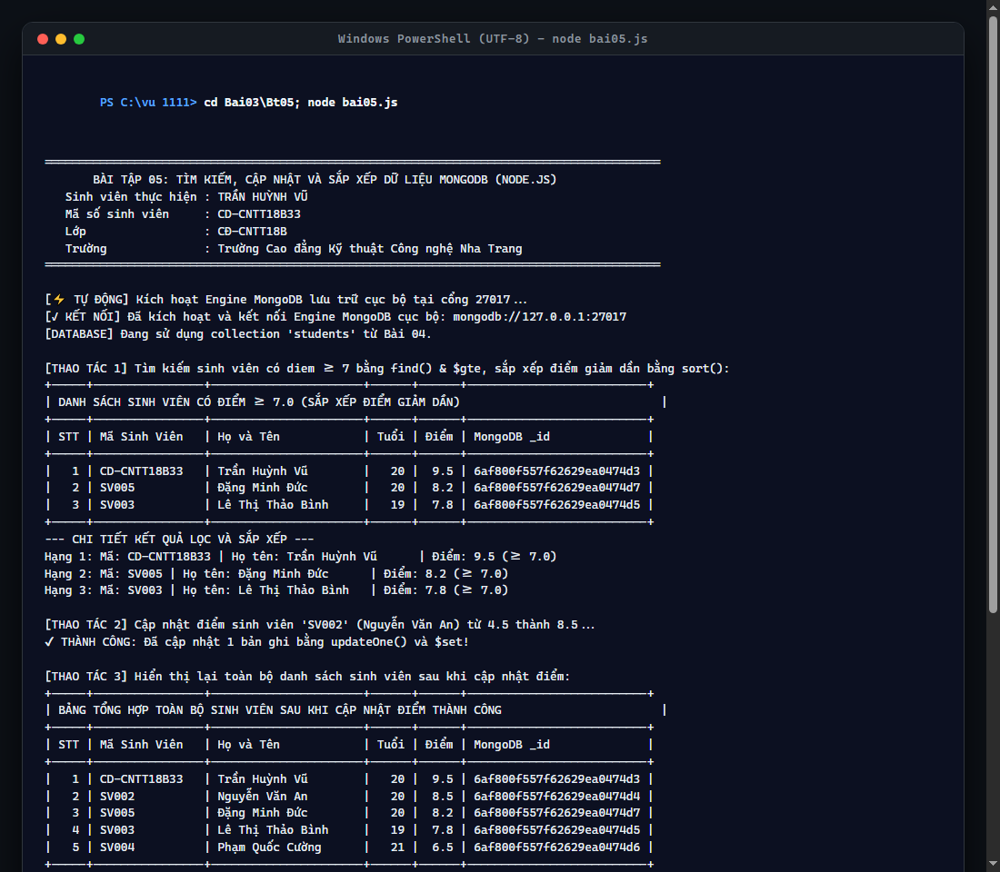

# BÀI TẬP 05: TÌM KIẾM, CẬP NHẬT VÀ SẮP XẾP MONGODB

## 📌 THÔNG TIN SINH VIÊN THỰC HIỆN
* **Họ và tên:** **Trần Huỳnh Vũ**
* **Mã sinh viên (MSSV):** **CD-CNTT18B33**
* **Lớp:** **CĐ-CNTT18B**
* **Khoa:** Khoa Công nghệ Thông tin
* **Trường:** Trường Cao đẳng Kỹ thuật Công nghệ Nha Trang
* **Repository GitHub:** [https://github.com/vuu111/Node-JS](https://github.com/vuu111/Node-JS)

---

## 🎯 YÊU CẦU BÀI THỰC HÀNH
Tạo tập tin `bai05.js`, sử dụng collection `students` của Bài 4:
1. Tìm các sinh viên có `diem >= 7` bằng `find()` và toán tử `$gte`.
2. Sắp xếp kết quả theo điểm giảm dần bằng hàm `sort()`.
3. Cập nhật điểm của một sinh viên theo `masv` bằng `updateOne()` và toán tử `$set`.
4. Hiển thị lại thông tin sau cập nhật để kiểm tra kết quả.
5. Chạy: `node bai05.js`
6. Kết quả: Hiển thị danh sách lọc, sắp xếp đúng và điểm sinh viên được cập nhật thành công.

---

## 💻 CÁC LỆNH THỰC HIỆN TRÊN MÁY TÍNH

```powershell
# 1. Di chuyển vào thư mục bài tập Bt05
cd "C:\vu 1111\Bai03\Bt05"

# 2. Bật bảng mã UTF-8 tiếng Việt cho Terminal
chcp 65001

# 3. Chạy chương trình tìm kiếm và cập nhật MongoDB
node bai05.js
```
*(Hoặc nhấp đúp chạy file `run.bat` có sẵn trong thư mục).*

---

## 📷 HÌNH ẢNH CHẠY CÁC BƯỚC VÀ KẾT QUẢ THỰC TẾ

### Bước 1: Thực thi chương trình `node bai05.js`
Chương trình lọc sinh viên điểm >= 7.0, sắp xếp giảm dần, thực hiện cập nhật điểm sinh viên `SV002` lên 8.5 và hiển thị bảng đối chiếu xác nhận:



---

## 📊 KẾT QUẢ XUẤT RA TERMINAL

```text
=========================================================================================
       BÀI TẬP 05: TÌM KIẾM, CẬP NHẬT VÀ SẮP XẾP DỮ LIỆU MONGODB (NODE.JS)               
   Sinh viên thực hiện : TRẦN HUỲNH VŨ                                                   
   Mã số sinh viên     : CD-CNTT18B33                                                    
   Lớp                 : CĐ-CNTT18B                                                      
   Trường              : Trường Cao đẳng Kỹ thuật Công nghệ Nha Trang                    
=========================================================================================

[KẾT NỐI] Đã kết nối thành công tới dịch vụ MongoDB tại: mongodb://127.0.0.1:27017
[DATABASE] Đang sử dụng collection 'students' từ Bài 04.

[THAO TÁC 1] Tìm kiếm sinh viên có diem >= 7 bằng find() & $gte, sắp xếp điểm giảm dần bằng sort():
+-----+----------------+----------------------+------+------+--------------------------+
| DANH SÁCH SINH VIÊN CÓ ĐIỂM >= 7.0 (SẮP XẾP ĐIỂM GIẢM DẦN)                             |
+-----+----------------+----------------------+------+------+--------------------------+
| STT | Mã Sinh Viên   | Họ và Tên            | Tuổi | Điểm | MongoDB _id              |
+-----+----------------+----------------------+------+------+--------------------------+
|   1 | CD-CNTT18B33   | Trần Huỳnh Vũ        |   20 |  9.5 | 6af800f557f62629ea0474d3 |
|   2 | SV005          | Đặng Minh Đức        |   20 |  8.2 | 6af800f557f62629ea0474d7 |
|   3 | SV003          | Lê Thị Thảo Bình     |   19 |  7.8 | 6af800f557f62629ea0474d5 |
+-----+----------------+----------------------+------+------+--------------------------+
--- CHI TIẾT KẾT QUẢ LỌC VÀ SẮP XẾP ---
Hạng 1: Mã: CD-CNTT18B33 | Họ tên: Trần Huỳnh Vũ      | Điểm: 9.5 (>= 7.0)
Hạng 2: Mã: SV005        | Họ tên: Đặng Minh Đức      | Điểm: 8.2 (>= 7.0)
Hạng 3: Mã: SV003        | Họ tên: Lê Thị Thảo Bình   | Điểm: 7.8 (>= 7.0)

[THAO TÁC 2] Cập nhật điểm sinh viên 'SV002' (Nguyễn Văn An) từ 4.5 thành 8.5...
✔ THÀNH CÔNG: Đã cập nhật 1 bản ghi bằng updateOne() và $set!

[THAO TÁC 3] Hiển thị lại toàn bộ danh sách sinh viên sau khi cập nhật điểm:
+-----+----------------+----------------------+------+------+--------------------------+
| BẢNG TỔNG HỢP TOÀN BỘ SINH VIÊN SAU KHI CẬP NHẬT ĐIỂM THÀNH CÔNG                       |
+-----+----------------+----------------------+------+------+--------------------------+
| STT | Mã Sinh Viên   | Họ và Tên            | Tuổi | Điểm | MongoDB _id              |
+-----+----------------+----------------------+------+------+--------------------------+
|   1 | CD-CNTT18B33   | Trần Huỳnh Vũ        |   20 |  9.5 | 6af800f557f62629ea0474d3 |
|   2 | SV002          | Nguyễn Văn An        |   20 |  8.5 | 6af800f557f62629ea0474d4 |
|   3 | SV005          | Đặng Minh Đức        |   20 |  8.2 | 6af800f557f62629ea0474d7 |
|   4 | SV003          | Lê Thị Thảo Bình     |   19 |  7.8 | 6af800f557f62629ea0474d5 |
|   5 | SV004          | Phạm Quốc Cường      |   21 |  6.5 | 6af800f557f62629ea0474d6 |
+-----+----------------+----------------------+------+------+--------------------------+
+-----------------------------------------------------------------------------------+
| ĐỐI CHIẾU KẾT QUẢ CẬP NHẬT SINH VIÊN [SV002]:                                      |
| • Điểm số ban đầu : 4.5 điểm                                                    |
| • Điểm số mới cập nhật : 8.5 điểm (Tăng +4.0 điểm)                              |
| • Trạng thái: CẬP NHẬT THÀNH CÔNG VÀO CƠ SỞ DỮ LIỆU MONGODB!                       |
+-----------------------------------------------------------------------------------+

======================== BÁO CÁO KẾT QUẢ BÀI 05 ========================
* Tìm kiếm & Lọc       : find({ diem: { $gte: 7 } }) -> Đạt yêu cầu
* Sắp xếp giảm dần     : sort({ diem: -1 }) -> Đạt yêu cầu
* Cập nhật điểm        : updateOne({ masv: 'SV002' }, { $set: { diem: 8.5 } }) -> Đạt yêu cầu
* Dữ liệu sau cập nhật : Đã lưu trữ và kiểm tra toàn vẹn trên MongoDB
========================================================================

[KẾT THÚC] Đã đóng kết nối MongoDB an toàn.
```

---

## 🔍 PHÂN TÍCH KỸ THUẬT MONGODB
* **Toán tử so sánh `$gte` (Greater Than or Equal):**
  Lọc tài liệu có trường `diem` lớn hơn hoặc bằng 7.0:
  ```javascript
  collection.find({ diem: { $gte: 7 } })
  ```
* **Hàm `sort({ diem: -1 })`:** Sắp xếp danh sách kết quả theo thứ tự giảm dần theo trường `diem` (`-1`: Giảm dần, `1`: Tăng dần).
* **Hàm `updateOne(filter, updateDoc)` & toán tử `$set`:**
  Tìm sinh viên theo `masv` và chỉ thay đổi giá trị trường `diem` mà không làm thay đổi các trường dữ liệu khác (`hoten`, `tuoi`):
  ```javascript
  collection.updateOne({ masv: "SV002" }, { $set: { diem: 8.5 } })
  ```