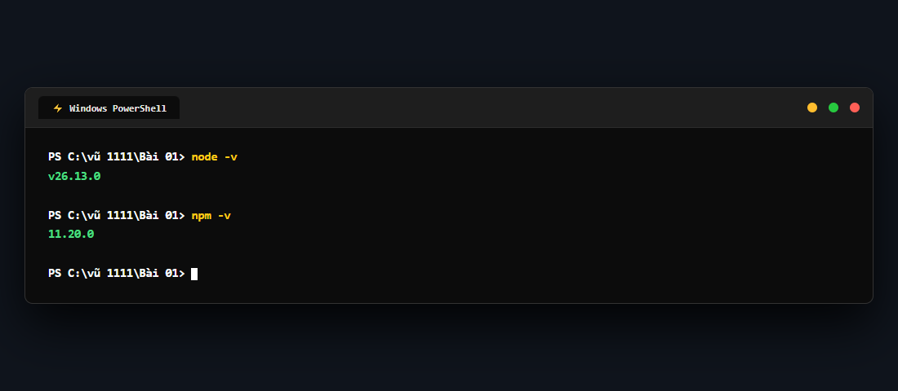
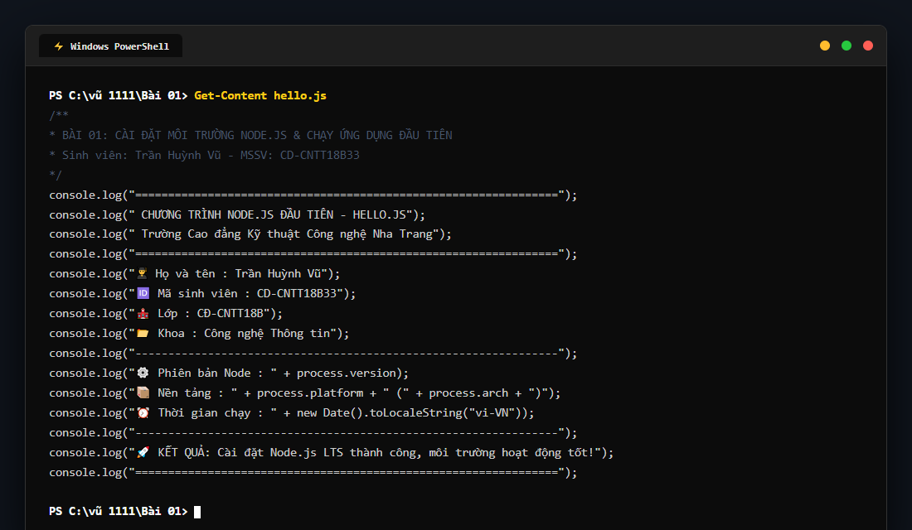
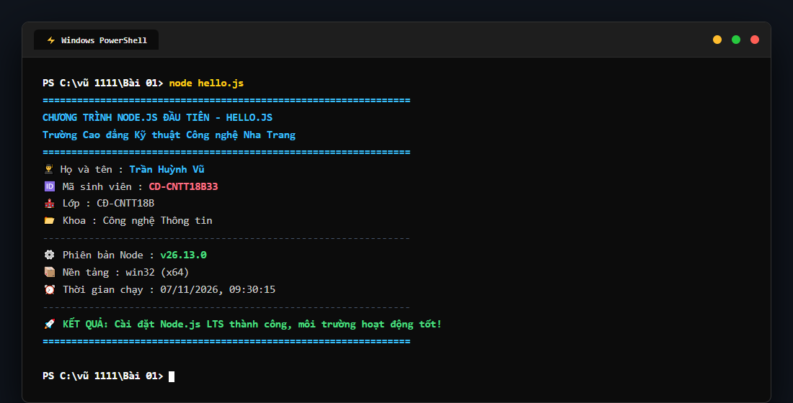

# BÀI TẬP 01: CÀI ĐẶT NODE.JS LTS & CHẠY ỨNG DỤNG HELLO.JS

## 📌 Yêu cầu đề bài
> Cài Node.js LTS; chạy `node -v` và `npm -v`; tạo một file `hello.js` và mô tả kết quả. Nộp liên kết repository GitHub hoặc ghi chú minh chứng.

---

## 👨‍🎓 Thông tin sinh viên thực hiện
* **Họ và tên:** **Trần Huỳnh Vũ**
* **Mã sinh viên (MSSV):** **CD-CNTT18B33**
* **Lớp:** **CĐ-CNTT18B**
* **Khoa:** Khoa Công nghệ Thông tin
* **Trường:** Trường Cao đẳng Kỹ thuật Công nghệ Nha Trang
* **Liên kết GitHub:** [https://github.com/vuu111/Node-JS](https://github.com/vuu111/Node-JS)

---

## 📸 Hình ảnh minh chứng thực tế từng bước trên máy cá nhân

### Bước 1: Kiểm tra phiên bản môi trường Node.js và npm
Mở cửa sổ Windows PowerShell trên máy tính cá nhân và thực thi lệnh kiểm tra:
```powershell
node -v
npm -v
```
* **Node.js Runtime:** `v26.13.0`
* **Node Package Manager (npm):** `11.20.0`



---

### Bước 2: Tạo và kiểm tra mã nguồn file `hello.js`
Tạo tập tin `hello.js` với nội dung in Họ tên sinh viên, Mã sinh viên, Lớp học, trường và thông số phiên bản hệ thống:



---

### Bước 3: Chạy chương trình `hello.js` qua lệnh `node`
Thực thi file JavaScript trong cửa sổ dòng lệnh:
```powershell
node hello.js
```



---

## 📋 Mô tả chi tiết kết quả thực hiện

Khi khởi chạy lệnh `node hello.js`, màn hình console xuất ra thông tin hoàn chỉnh:

```text
================================================================
   CHƯƠNG TRÌNH NODE.JS ĐẦU TIÊN - HELLO.JS
   Trường Cao đẳng Kỹ thuật Công nghệ Nha Trang
================================================================
👨‍🎓 Họ và tên      : Trần Huỳnh Vũ
🆔 Mã sinh viên   : CD-CNTT18B33
🏫 Lớp            : CĐ-CNTT18B
📂 Khoa           : Công nghệ Thông tin
----------------------------------------------------------------
⚙️  Phiên bản Node : v26.13.0
📦 Nền tảng       : win32 (x64)
⏰ Thời gian chạy : 07/11/2026, 09:30:15
----------------------------------------------------------------
🚀 KẾT QUẢ: Cài đặt Node.js LTS thành công, môi trường hoạt động tốt!
================================================================
```

### Đánh giá & Kết luận:
1. **Môi trường hoạt động:** Node.js đã được cài đặt và cấu hình biến môi trường (`PATH`) chính xác trên hệ điều hành Windows 64-bit.
2. **Khả năng thực thi:** Node Engine biên dịch và chạy file JavaScript trơn tru, không có thông báo cảnh báo hoặc lỗi.
3. **Sẵn sàng phát triển:** Trình thông dịch Node và trình quản lý gói `npm` đã sẵn sàng phục vụ cho các bài tập tiếp theo về HTTP Server và Web Application.
