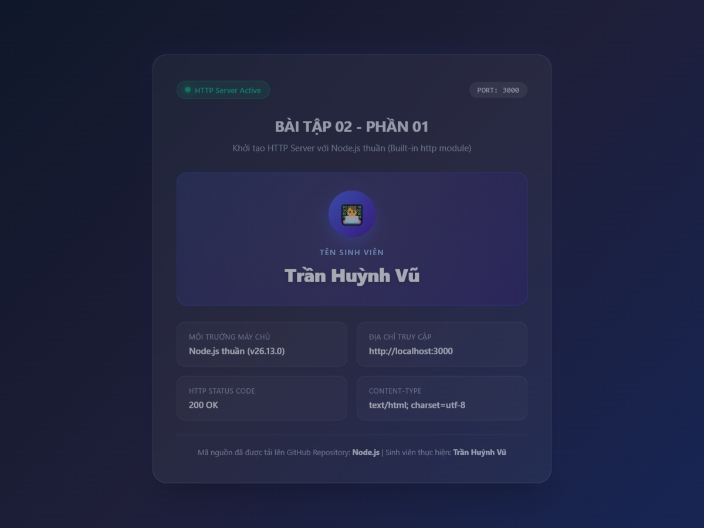

# BÀI TẬP 02 - PHẦN 01: HTTP SERVER BẰNG NODE.JS THUẦN

## 📌 Yêu cầu đề bài
> **Yêu cầu 1:** Tạo HTTP server bằng Node.js thuần; truy cập `localhost:3000` và trả về trang HTML chứa tên sinh viên. Đẩy mã nguồn lên GitHub.

---

## 👨‍🎓 Thông tin sinh viên
* **Họ và tên:** Trần Huỳnh Vũ
* **Mã sinh viên (MSSV):** CD-CNTT18B33
* **Lớp:** CĐ-CNTT18B
* **Khoa / Trường:** Khoa Công nghệ Thông tin / Trường Cao đẳng Kỹ thuật Công nghệ Nha Trang
* **Repository GitHub:** [https://github.com/TranHuynhVu/Node.js](https://github.com/TranHuynhVu/Node.js)

---

## 🛠️ Cấu trúc thư mục
```
Bài 02/01/
├── server.js        # Mã nguồn HTTP Server bằng Node.js thuần (module http)
├── package.json     # File cấu hình và script khởi chạy ứng dụng
├── screenshot.png   # Ảnh chụp màn hình kết quả chạy thực tế tại localhost:3000
└── README.md        # Hướng dẫn chi tiết cách chạy code và giải thích
```

---

## 🚀 Hướng dẫn cách chạy mã nguồn

### 1. Yêu cầu môi trường
* Đã cài đặt **Node.js** (khuyến nghị phiên bản 18+ hoặc 20+ LTS trở lên).
* Trình duyệt web bất kỳ (Chrome, Edge, Firefox,...).

### 2. Các bước thực hiện

#### Bước 1: Mở Terminal / PowerShell và di chuyển vào thư mục bài tập
```powershell
cd "Bài 02/01"
```

#### Bước 2: Khởi động máy chủ HTTP
Bạn có thể sử dụng 1 trong 2 cách sau:

* **Cách 1 (Sử dụng Node.js trực tiếp):**
  ```powershell
  node server.js
  ```

* **Cách 2 (Sử dụng script npm):**
  ```powershell
  npm start
  ```

Sau khi chạy lệnh, màn hình Terminal sẽ hiển thị thông báo:
```text
====================================================
[Bài 02 - Phần 01] HTTP Server đang chạy thành công!
Truy cập máy chủ tại: http://localhost:3000
Sinh viên: Trần Huỳnh Vũ
====================================================
```

#### Bước 3: Xem kết quả trên trình duyệt
Mở trình duyệt web và nhập đường dẫn:
```
http://localhost:3000
```
Trang web sẽ phản hồi trang HTML hiển thị tên sinh viên **Trần Huỳnh Vũ** cùng trạng thái máy chủ hoạt động bình thường.

---

## 📸 Hình ảnh minh chứng kết quả chạy thực tế

Dưới đây là ảnh chụp màn hình máy chủ hoạt động thực tế trên máy tính tại `http://localhost:3000`:



---

## 💡 Giải thích mã nguồn chi tiết (`server.js`)
* **Module `http`:** Sử dụng module có sẵn của Node.js qua lệnh `require('http')`, không cần cài thêm thư viện phụ thuộc từ bên ngoài (thuần Node.js).
* **`http.createServer((req, res) => { ... })`:** Khởi tạo Web Server tiếp nhận các kết nối từ client (trình duyệt).
* **`res.writeHead(200, { 'Content-Type': 'text/html; charset=utf-8' })`:** Trả về mã trạng thái HTTP 200 (Thành công) cùng tiêu đề UTF-8 để hỗ trợ hiển thị tiếng Việt có dấu đầy đủ, sắc nét.
* **`res.end(htmlContent)`:** Kết thúc luồng phản hồi và gửi nội dung trang HTML chứa thông tin sinh viên tới trình duyệt.
* **`server.listen(3000, 'localhost', ...)`:** Đặt máy chủ lắng nghe tại cổng 3000 trên máy cục bộ (localhost).
