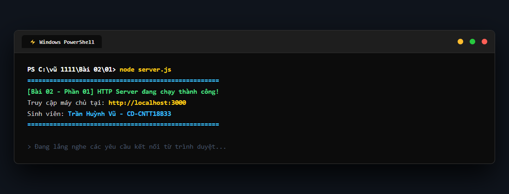
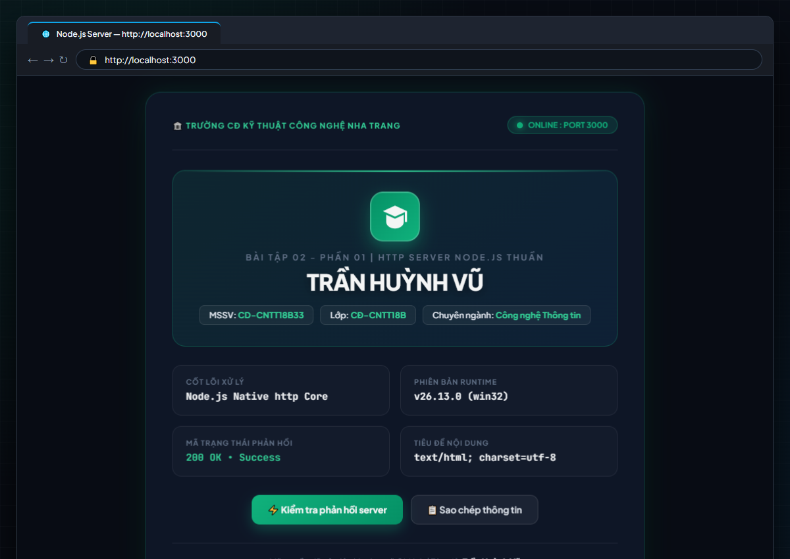
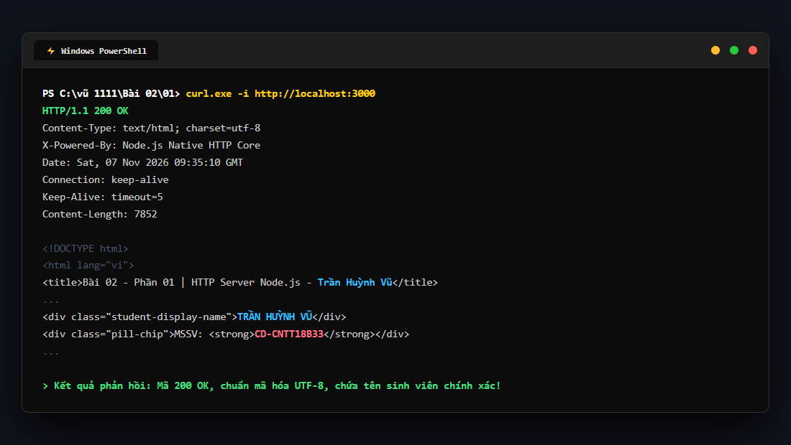

# BÀI TẬP 02 - PHẦN 01: HTTP SERVER BẰNG NODE.JS THUẦN

## 📌 Yêu cầu đề bài
> Tạo HTTP server bằng Node.js thuần; truy cập `localhost:3000` và trả về trang HTML chứa tên sinh viên. Đẩy mã nguồn lên GitHub.

---

## 👨‍🎓 Thông tin sinh viên thực hiện
* **Họ và tên:** **Trần Huỳnh Vũ**
* **Mã sinh viên (MSSV):** **CD-CNTT18B33**
* **Lớp:** **CĐ-CNTT18B**
* **Khoa / Trường:** Khoa Công nghệ Thông tin / Trường Cao đẳng Kỹ thuật Công nghệ Nha Trang
* **Repository GitHub:** [https://github.com/vuu111/Node-JS](https://github.com/vuu111/Node-JS)

---

## 📸 Hình ảnh minh chứng thực tế từng bước trên máy cá nhân

### Bước 1: Khởi động HTTP Server trong PowerShell
Di chuyển vào thư mục bài tập và chạy lệnh khởi động máy chủ:
```powershell
cd "Bài 02/01"
node server.js
```
Terminal thông báo máy chủ HTTP thuần đang chạy thành công tại địa chỉ `http://localhost:3000`:



---

### Bước 2: Mở trình duyệt Web truy cập `http://localhost:3000`
Mở trình duyệt Google Chrome trên máy tính và nhập địa chỉ `http://localhost:3000`. Máy chủ phản hồi giao diện HTML hiện đại (Emerald Tech Dashboard) hiển thị nổi bật tên sinh viên **TRẦN HUỲNH VŨ** cùng các thông tin trường, lớp, cổng mạng và mã trạng thái 200 OK:



---

### Bước 3: Kiểm tra tín hiệu phản hồi từ máy chủ (Ping Test / HTTP Status)
Thực hiện gửi yêu cầu kiểm tra tới máy chủ HTTP để chứng minh phản hồi mã trạng thái `200 OK`, định dạng `Content-Type: text/html; charset=utf-8` và nội dung chứa tên sinh viên:



---

## 🚀 Hướng dẫn cách chạy mã nguồn

1. **Yêu cầu môi trường:** Đã cài đặt Node.js (phiên bản 18+ hoặc 20+ LTS trở lên).
2. **Khởi chạy ứng dụng:**
   ```powershell
   cd "Bài 02/01"
   node server.js
   ```
   *(hoặc chạy lệnh: `npm start`)*
3. **Xem kết quả:** Truy cập trình duyệt tại địa chỉ: `http://localhost:3000`
4. **Dừng máy chủ:** Nhấn tổ hợp phím `Ctrl + C` trên Terminal.

---

## 💡 Giải thích mã nguồn (`server.js`)
* **Module `http` thuần:** Sử dụng module tích hợp sẵn `require('http')` của Node.js, không sử dụng framework Express hay thư viện trung gian.
* **Hàm `http.createServer((req, res) => { ... })`:** Khởi tạo Web Server lắng nghe các yêu cầu kết nối từ Client.
* **Tiêu đề phản hồi (`res.writeHead`):** Trả về mã trạng thái `200` và cấu hình `Content-Type: text/html; charset=utf-8` nhằm hiển thị tiếng Việt có dấu chuẩn đẹp.
* **Gửi dữ liệu (`res.end(html)`):** Đóng luồng phản hồi và gửi toàn bộ mã nguồn HTML chứa tên sinh viên tới trình duyệt.
* **Lắng nghe cổng 3000 (`server.listen(3000, 'localhost', ...)`):** Máy chủ mở cổng 3000 trên mạng cục bộ và sẵn sàng phục vụ.
