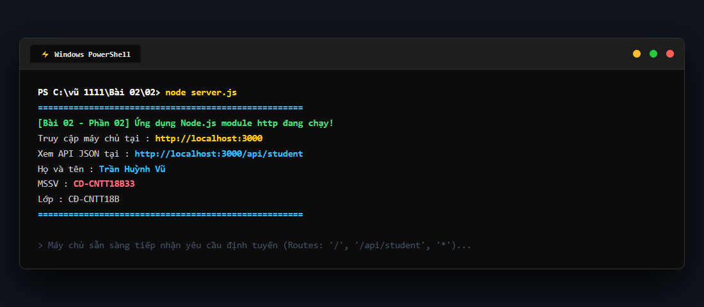
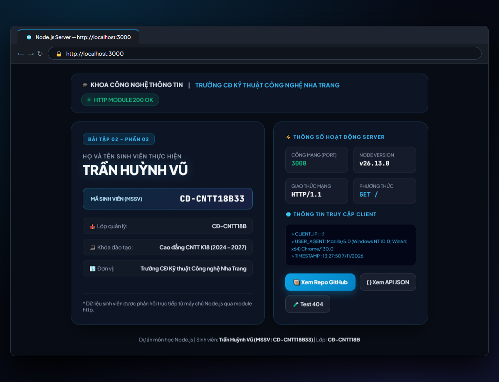
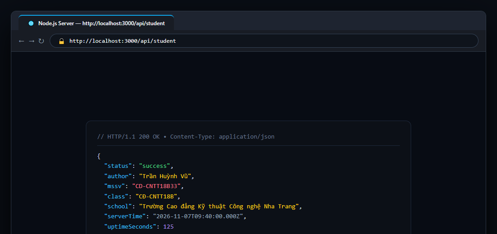
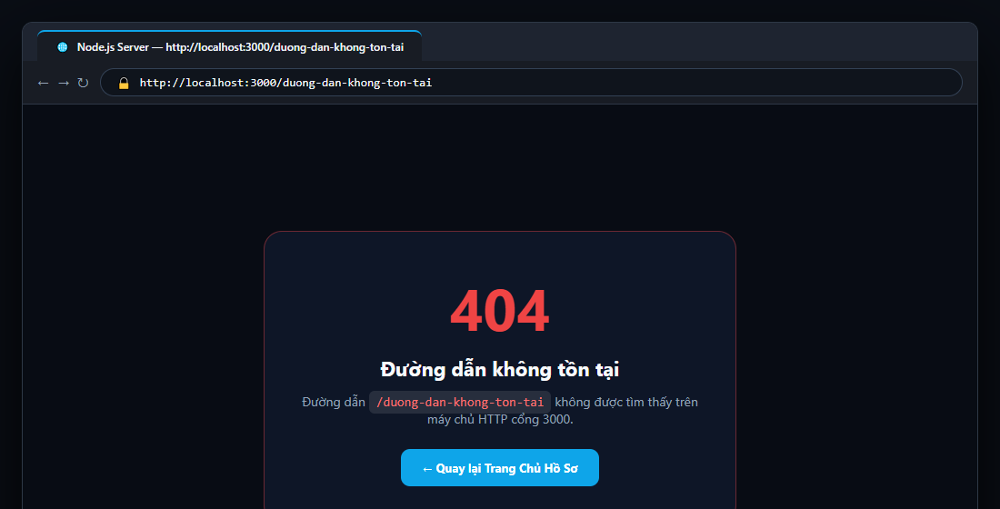

# BÀI TẬP 02 - PHẦN 02: ỨNG DỤNG NODE.JS SỬ DỤNG MODULE HTTP

## 📌 Yêu cầu đề bài
> Tạo ứng dụng Node.js sử dụng module `http`. Server chạy tại cổng 3000. Khi truy cập trang chủ, trả về HTML có họ tên và mã sinh viên. Nộp liên kết GitHub và mô tả cách chạy.

---

## 👨‍🎓 Thông tin sinh viên thực hiện
* **Họ và tên:** **Trần Huỳnh Vũ**
* **Mã sinh viên (MSSV):** **CD-CNTT18B33**
* **Lớp:** **CĐ-CNTT18B**
* **Khoa / Trường:** Khoa Công nghệ Thông tin / Trường Cao đẳng Kỹ thuật Công nghệ Nha Trang
* **Repository GitHub:** [https://github.com/vuu111/Node-JS](https://github.com/vuu111/Node-JS)

---

## 📸 Hình ảnh minh chứng thực tế từng bước trên máy cá nhân

### Bước 1: Khởi động máy chủ ứng dụng trong PowerShell
Mở PowerShell tại thư mục `Bài 02/02` và thực thi:
```powershell
cd "Bài 02/02"
node server.js
```
Console ghi nhận máy chủ khởi động thành công và cung cấp các địa chỉ truy cập:



---

### Bước 2: Truy cập trang chủ `http://localhost:3000` (Hiển thị Họ tên & MSSV)
Khi mở `http://localhost:3000` trên trình duyệt, máy chủ phản hồi giao diện Bento-Box Cyan hiện đại với thẻ hồ sơ sinh viên số hóa, hiển thị chính xác **Họ và tên: TRẦN HUỲNH VŨ** và **MSSV: CD-CNTT18B33** cùng các thông số máy chủ thời gian thực:



---

### Bước 3: Kiểm tra Endpoint API JSON tại `/api/student`
Truy cập đường dẫn `http://localhost:3000/api/student` để kiểm tra khả năng xử lý định tuyến trả về dữ liệu API định dạng JSON chuẩn của sinh viên:



---

### Bước 4: Kiểm tra định tuyến bắt lỗi 404 (Route Not Found)
Truy cập một đường dẫn không tồn tại (ví dụ: `http://localhost:3000/duong-dan-khong-ton-tai`), máy chủ phản hồi trang thông báo lỗi 404 thân thiện kèm nút quay về trang chủ:



---

## 🚀 Hướng dẫn cách chạy mã nguồn

1. **Di chuyển vào thư mục bài tập:**
   ```powershell
   cd "Bài 02/02"
   ```
2. **Khởi động máy chủ:**
   ```powershell
   node server.js
   ```
   *(hoặc sử dụng lệnh: `npm start`)*
3. **Các địa chỉ kiểm tra:**
   * **Trang chủ (Họ tên & MSSV):** [http://localhost:3000](http://localhost:3000)
   * **API JSON sinh viên:** [http://localhost:3000/api/student](http://localhost:3000/api/student)
   * **Kiểm tra Route 404:** [http://localhost:3000/test-404](http://localhost:3000/test-404)
4. **Dừng máy chủ:** Nhấn `Ctrl + C` trên Terminal.

---

## 💡 Giải thích mã nguồn chi tiết (`server.js`)
* **Module `http`:** Khởi tạo HTTP Server với `http.createServer((req, res) => { ... })`.
* **Cơ chế định tuyến (Routing):**
  - Sử dụng đối tượng `new URL(req.url, ...)` để trích xuất chính xác đường dẫn `pathname`.
  - Phân nhánh điều kiện:
    - `pathname === '/' || pathname === '/index.html'`: Trả về giao diện HTML thẻ sinh viên có họ tên và mã sinh viên.
    - `pathname === '/api/student'`: Trả về dữ liệu JSON của sinh viên (`Content-Type: application/json`).
    - Các trường hợp còn lại: Trả về mã trạng thái `404` cùng giao diện lỗi.
* **Lắng nghe cổng 3000:** Gọi `server.listen(3000, 'localhost')` để máy chủ đón nhận các kết nối mạng.
