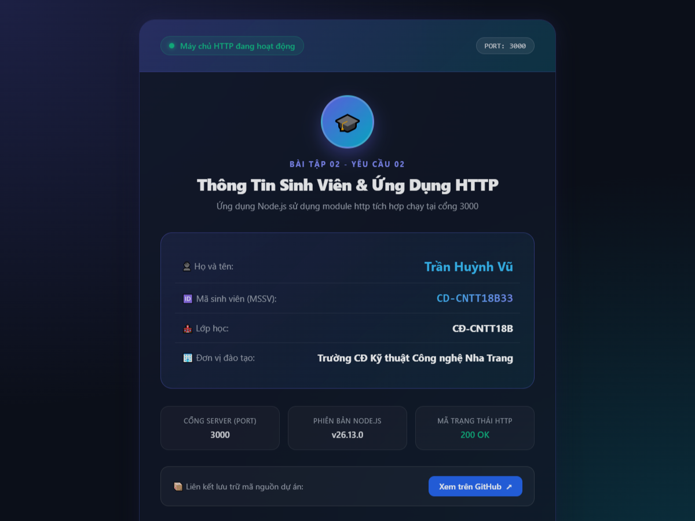

# BÀI TẬP 02 - PHẦN 02: ỨNG DỤNG NODE.JS SỬ DỤNG MODULE HTTP

## 📌 Yêu cầu đề bài
> **Yêu cầu 2:** Tạo ứng dụng Node.js sử dụng module `http`. Server chạy tại cổng 3000. Khi truy cập trang chủ, trả về HTML có họ tên và mã sinh viên. Nộp liên kết GitHub và mô tả cách chạy.

---

## 👨‍🎓 Thông tin sinh viên
* **Họ và tên:** Trần Huỳnh Vũ
* **Mã sinh viên (MSSV):** CD-CNTT18B33
* **Lớp:** CĐ-CNTT18B
* **Khoa / Trường:** Khoa Công nghệ Thông tin / Trường Cao đẳng Kỹ thuật Công nghệ Nha Trang
* **Repository GitHub:** [https://github.com/TranHuynhVu/Node.js](https://github.com/TranHuynhVu/Node.js)

---

## 🛠️ Cấu trúc thư mục
```
Bài 02/02/
├── server.js        # Ứng dụng Node.js sử dụng module http tích hợp
├── package.json     # Cấu hình dự án và script npm
├── screenshot.png   # Ảnh chụp màn hình kết quả chạy thực tế tại localhost:3000
└── README.md        # Hướng dẫn chi tiết cách chạy và giải thích mã nguồn
```

---

## 🚀 Hướng dẫn cách chạy mã nguồn

### 1. Yêu cầu môi trường
* Đã cài đặt **Node.js** (khuyến nghị phiên bản 18+ hoặc 20+ LTS trở lên).
* Trình duyệt web bất kỳ (Google Chrome, Microsoft Edge, Firefox,...).

### 2. Các bước thực hiện

#### Bước 1: Mở Terminal / PowerShell và di chuyển vào thư mục bài tập
```powershell
cd "Bài 02/02"
```

#### Bước 2: Khởi động máy chủ Node.js
Bạn có thể chọn 1 trong 2 lệnh sau:

* **Cách 1: Chạy trực tiếp với Node.js:**
  ```powershell
  node server.js
  ```

* **Cách 2: Chạy thông qua npm script:**
  ```powershell
  npm start
  ```

Màn hình console sẽ xuất thông tin xác nhận:
```text
====================================================
[Bài 02 - Phần 02] Ứng dụng Node.js module http đang chạy!
Truy cập máy chủ tại: http://localhost:3000
Họ và tên: Trần Huỳnh Vũ
MSSV     : CD-CNTT18B33
Lớp      : CĐ-CNTT18B
Trường   : Trường Cao đẳng Kỹ thuật Công nghệ Nha Trang
====================================================
```

#### Bước 3: Kiểm tra trên trình duyệt
1. **Truy cập trang chủ:** Mở trình duyệt và truy cập `http://localhost:3000` (hoặc `http://localhost:3000/index.html`). Màn hình sẽ phản hồi trang HTML hiển thị đầy đủ Họ tên (**Trần Huỳnh Vũ**) và Mã sinh viên (**CD-CNTT18B33**) cùng các thông tin lớp học và trạng thái máy chủ.
2. **Kiểm tra route khác (404 Not Found):** Nếu truy cập một đường dẫn bất kỳ khác (ví dụ: `http://localhost:3000/test`), hệ thống sẽ trả về trang thông báo lỗi 404 thân thiện.

---

## 📸 Hình ảnh minh chứng kết quả chạy thực tế

Ảnh chụp màn hình thực tế khi truy cập vào `http://localhost:3000` trên máy tính:



---

## 💡 Giải thích mã nguồn chi tiết (`server.js`)
* **Sử dụng module `http` chuẩn:** Sử dụng module `http` được tích hợp sẵn trong Node.js để tạo HTTP server mà không phụ thuộc vào framework ngoài.
* **Xử lý định tuyến (Routing):** 
  - Sử dụng đối tượng `URL` để trích xuất `pathname` từ URL yêu cầu.
  - Phân luồng điều kiện: Khi `pathname === '/'` hoặc `pathname === '/index.html'`, máy chủ trả về mã trạng thái `200` cùng mã HTML chứa Họ và tên sinh viên và MSSV.
  - Các đường dẫn khác sẽ được điều hướng vào khối mã lỗi `404 Not Found`.
* **Tiêu đề phản hồi (Response Headers):** Cấu hình `Content-Type: text/html; charset=utf-8` để hiển thị tiếng Việt chính xác và sắc nét trên mọi trình duyệt.
* **Lắng nghe cổng 3000:** Gọi `server.listen(PORT, HOST)` để máy chủ sẵn sàng đón nhận và xử lý các yêu cầu HTTP tại cổng 3000.
