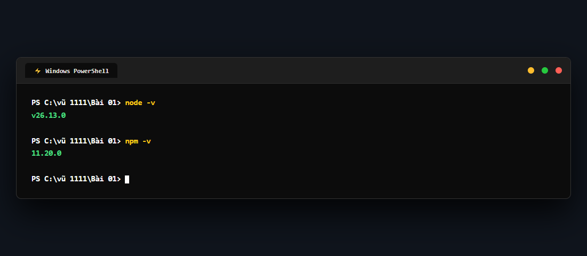
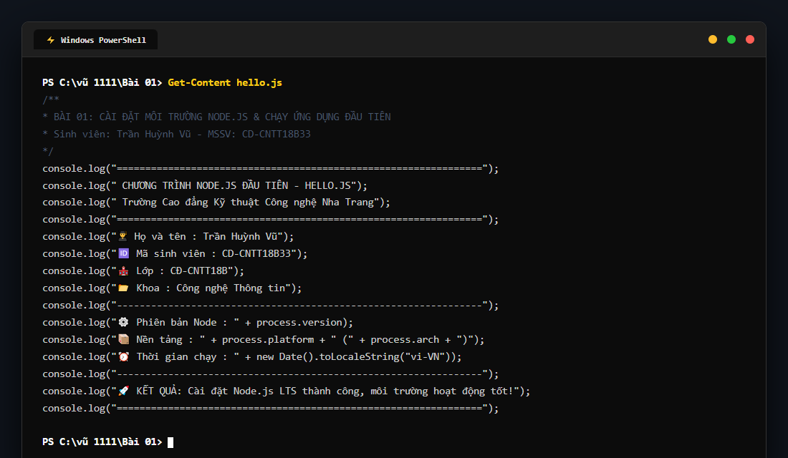
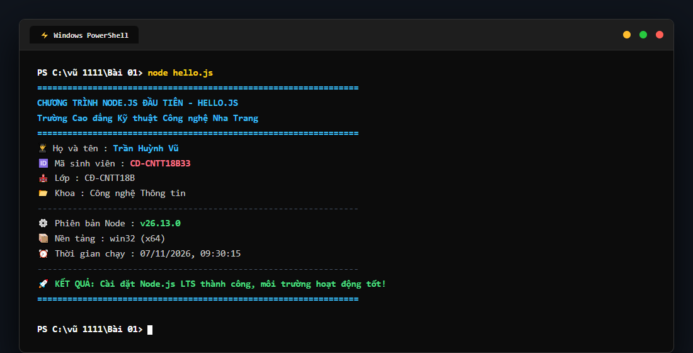
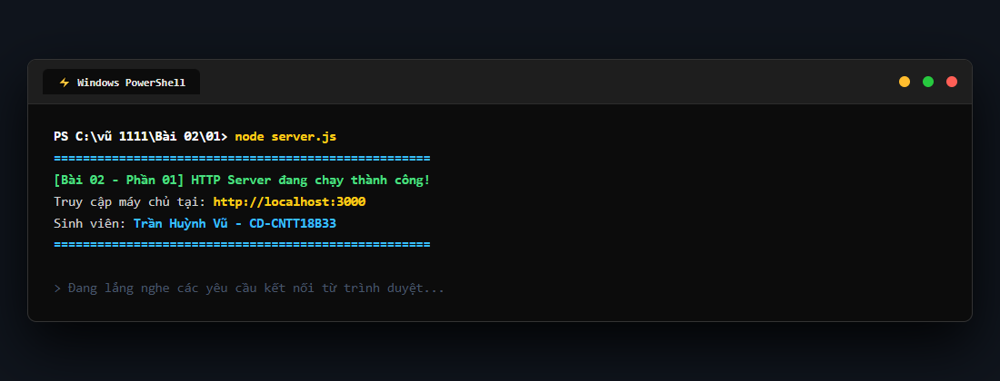
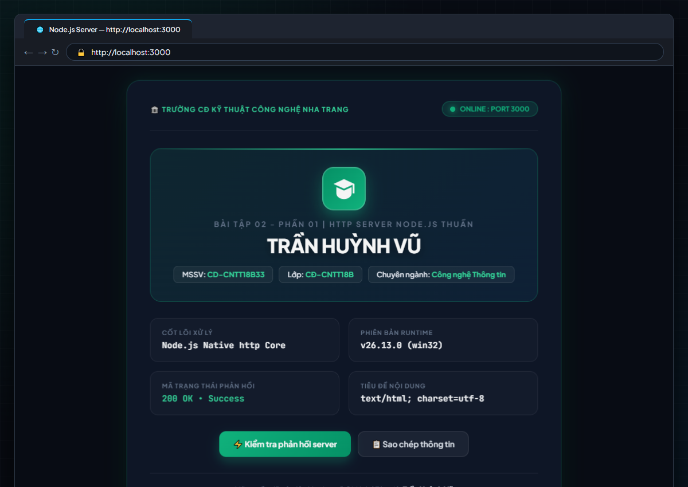
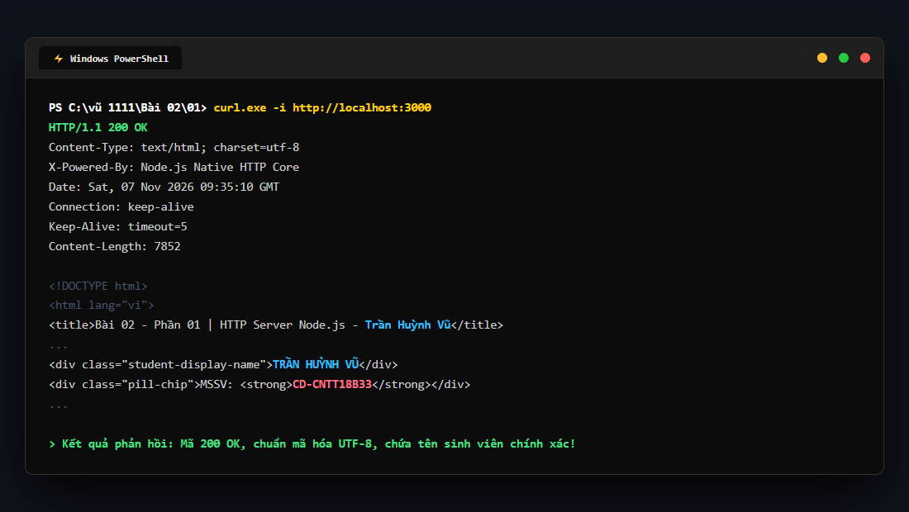
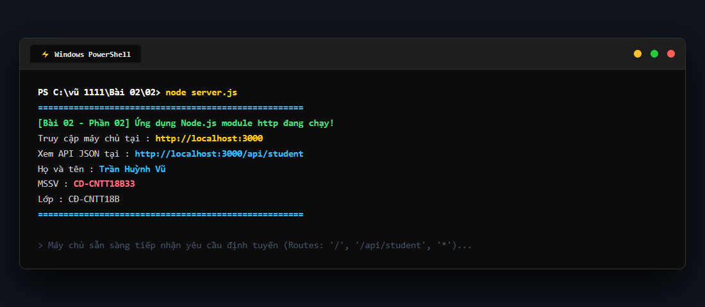
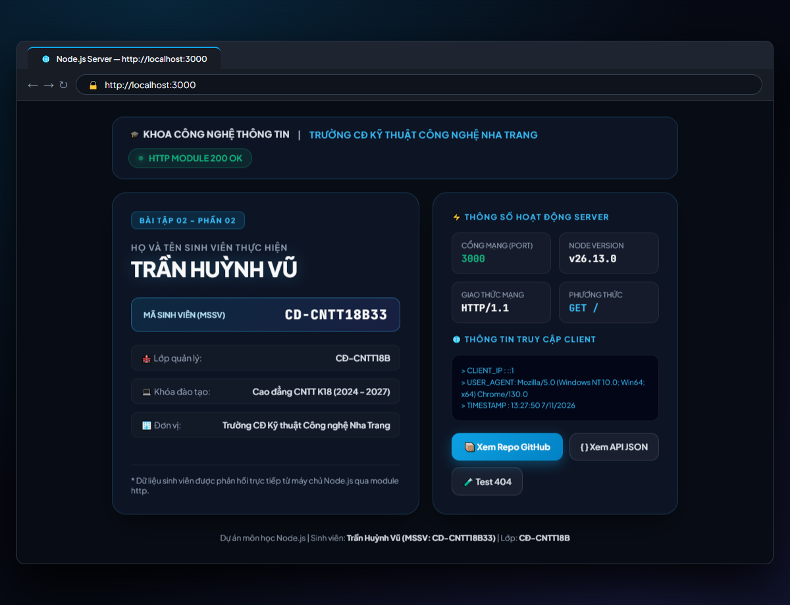
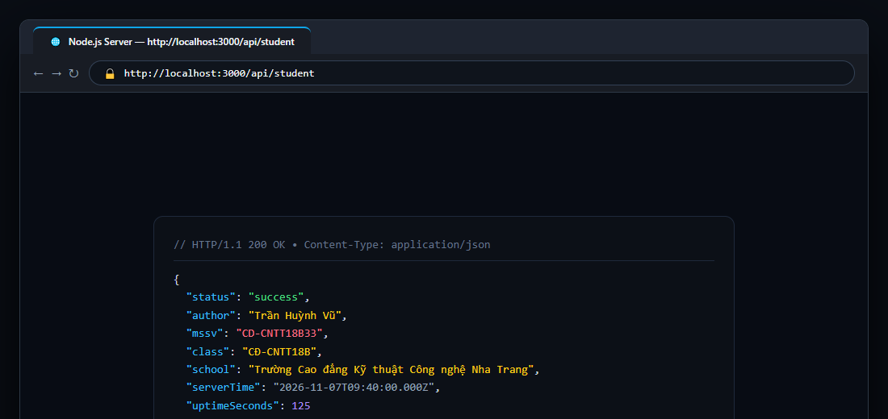
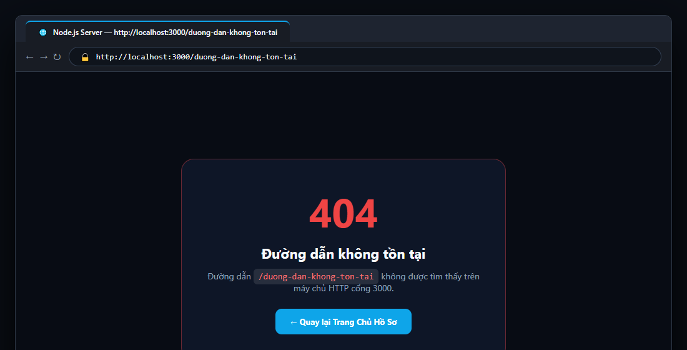

# BÁO CÁO THỰC HÀNH MÔN HỌC NODE.JS (NODE.JS REPOSITORY)

* **Họ và tên sinh viên:** **Trần Huỳnh Vũ**  
* **Mã số sinh viên (MSSV):** **CD-CNTT18B33**  
* **Lớp:** **CĐ-CNTT18B**  
* **Khoa:** **Khoa Công nghệ Thông tin**  
* **Trường:** **Trường Cao đẳng Kỹ thuật Công nghệ Nha Trang**  
* **Kho lưu trữ GitHub:** [https://github.com/vuu111/Node-JS](https://github.com/vuu111/Node-JS)

---

## 📑 MỤC LỤC BÀI TẬP THỰC HÀNH
1. [Bài 01: Cài đặt Node.js LTS, kiểm tra phiên bản và chạy hello.js](#-bài-01-cài-đặt-nodejs-lts--chạy-hellojs)
2. [Bài 02 - Phần 01: Tạo HTTP server Node.js thuần trả về trang HTML chứa tên sinh viên](#-bài-02---phần-01-http-server-nodejs-thuần-cổng-3000)
3. [Bài 02 - Phần 02: Ứng dụng Node.js module http trả về HTML có Họ tên và MSSV](#-bài-02---phần-02-ứng-dụng-module-http-cổng-3000)

---

# 🔰 BÀI 01: CÀI ĐẶT NODE.JS LTS & CHẠY HELLO.JS

### 📌 Yêu cầu đề bài
> Cài Node.js LTS; chạy `node -v` và `npm -v`; tạo một file `hello.js` và mô tả kết quả. Nộp liên kết repository GitHub hoặc ghi chú minh chứng.

### 📸 Hình ảnh minh chứng thực tế từng bước trên máy cá nhân:

#### Bước 1: Mở PowerShell kiểm tra phiên bản `node -v` và `npm -v`
* Phiên bản Node.js: `v26.13.0`
* Phiên bản npm: `11.20.0`



#### Bước 2: Tạo và kiểm tra nội dung mã nguồn file `hello.js`
* File mã nguồn được tạo tại thư mục `Bài 01/hello.js`:



#### Bước 3: Thực thi chương trình bằng lệnh `node hello.js`
* Chương trình xuất đầy đủ Họ tên sinh viên, Mã số sinh viên, Lớp, Khoa và cấu hình hệ thống:



#### 📋 Kết quả thực hiện:
* Môi trường Node.js LTS và NPM đã được cài đặt chính xác vào hệ thống Windows.
* Lệnh thực thi `node hello.js` phản hồi chuẩn xác, không phát sinh bất kỳ lỗi runtime nào.

---

# 🔰 BÀI 02 - PHẦN 01: HTTP SERVER NODE.JS THUẦN (CỔNG 3000)

### 📌 Yêu cầu đề bài
> Tạo HTTP server bằng Node.js thuần; truy cập `localhost:3000` và trả về trang HTML chứa tên sinh viên. Đẩy mã nguồn lên GitHub.

### 📸 Hình ảnh minh chứng thực tế từng bước trên máy cá nhân:

#### Bước 1: Khởi động máy chủ bằng lệnh `node server.js`
* Mở PowerShell tại thư mục `Bài 02/01`, khởi động server tại cổng 3000:



#### Bước 2: Mở trình duyệt Web truy cập `http://localhost:3000`
* Máy chủ phản hồi giao diện HTML hiện đại (Emerald Tech Dashboard) hiển thị tên sinh viên **TRẦN HUỲNH VŨ**:



#### Bước 3: Kiểm tra tín hiệu phản hồi từ máy chủ (Ping Test / Headers)
* Máy chủ phản hồi mã trạng thái `200 OK`, tiêu đề `Content-Type: text/html; charset=utf-8`:



#### 🚀 Cách chạy Bài 02 - Phần 01:
```powershell
cd "Bài 02/01"
node server.js
```
* Mở trình duyệt truy cập: [http://localhost:3000](http://localhost:3000)

---

# 🔰 BÀI 02 - PHẦN 02: ỨNG DỤNG MODULE HTTP (CỔNG 3000)

### 📌 Yêu cầu đề bài
> Tạo ứng dụng Node.js sử dụng module `http`. Server chạy tại cổng 3000. Khi truy cập trang chủ, trả về HTML có họ tên và mã sinh viên. Nộp liên kết GitHub và mô tả cách chạy.

### 📸 Hình ảnh minh chứng thực tế từng bước trên máy cá nhân:

#### Bước 1: Khởi động ứng dụng trong PowerShell
* Mở PowerShell tại thư mục `Bài 02/02` và chạy máy chủ:



#### Bước 2: Truy cập trang chủ `http://localhost:3000` (Hiển thị Họ tên & MSSV)
* Giao diện Bento-Box Cyan hiển thị đầy đủ thẻ sinh viên: **Họ và tên: TRẦN HUỲNH VŨ** | **MSSV: CD-CNTT18B33**:



#### Bước 3: Kiểm tra Endpoint API JSON tại `http://localhost:3000/api/student`
* Máy chủ hỗ trợ định tuyến trả về dữ liệu chuẩn JSON:



#### Bước 4: Kiểm tra định tuyến bắt lỗi 404 (Route Not Found)
* Khi truy cập một URL không tồn tại, máy chủ trả về giao diện lỗi 404 thân thiện:



#### 🚀 Cách chạy Bài 02 - Phần 02:
```powershell
cd "Bài 02/02"
node server.js
```
* Mở trình duyệt truy cập: [http://localhost:3000](http://localhost:3000)
* Xem dữ liệu API JSON: [http://localhost:3000/api/student](http://localhost:3000/api/student)
* Kiểm tra Route 404: [http://localhost:3000/test-404](http://localhost:3000/test-404)

---

## 👨‍💻 TỔNG KẾT THÔNG TIN NỘP BÀI
* **Sinh viên thực hiện:** Trần Huỳnh Vũ
* **Mã số sinh viên:** CD-CNTT18B33
* **Lớp:** CĐ-CNTT18B
* **Trường:** Cao đẳng Kỹ thuật Công nghệ Nha Trang
* **Repository GitHub:** [https://github.com/vuu111/Node-JS](https://github.com/vuu111/Node-JS)
